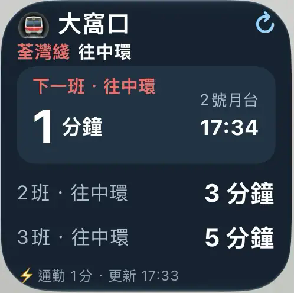
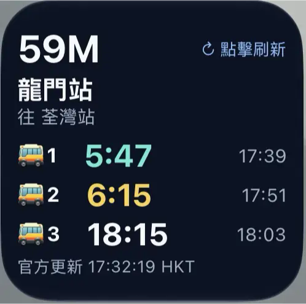

# Hong Kong Transit ETA Widgets for Scriptable
**香港交通實時到站 Widget｜港鐵 + 九巴／城巴** · [廣東話](#廣東話--安裝與設計) · [English](#english--setup-and-methodology)

Two standalone iPhone Home Screen widgets powered by public transport APIs, with customizable workdays, commute windows, and iOS-aware adaptive refresh requests. No API keys, backend service, analytics, or paid subscription required.

**Important:** This is an independent, unofficial project. ETA data comes from the transport operators; the project is not affiliated with MTR, KMB or Citybus. iOS controls actual Home Screen widget reloads; no setting guarantees real-time background polling.

## Screenshots / 截圖

<table><tr><th>MTR 港鐵</th><th>Bus 巴士</th></tr>
<tr><td></td><td></td></tr>
</table>

Screenshots were cropped from a user-provided iPhone image. They illustrate the installed widgets, not a live feed. **The MTR script in this repository is a newly developed public implementation; its layout and behavior may differ from the MTR script used to produce the screenshot.**

## Files / 檔案

| File | Description |
|---|---|
| [scripts/HK-Bus-ETA.js](scripts/HK-Bus-ETA.js) | KMB and Citybus ETA widget; 3 upcoming buses; HKT official timestamp; independent favorites; adaptive workdays |
| [scripts/HK-MTR-Next-Train.js](scripts/HK-MTR-Next-Train.js) | New MTR Next Train implementation; line/station/UP/DOWN/BOTH; independent favorite; adaptive workdays |
| [docs/METHODOLOGY.md](docs/METHODOLOGY.md) | Technical architecture, API freshness, scheduling, failure modes, privacy, validation / 詳細原理 |
| [assets/mtr-widget.svg](assets/mtr-widget.svg) | Cropped image preview embedded in SVG |
| [assets/bus-widget.svg](assets/bus-widget.svg) | Cropped image preview embedded in SVG |

---

## 廣東話 — 安裝與設計

### 1. 需要準備

iPhone、[Scriptable](https://apps.apple.com/app/scriptable/id1405459188)、網絡連接。無須 API Key、登入第三方服務或者自設伺服器。

### 2. 安裝巴士 Widget

1. 開啟 [HK-Bus-ETA.js](scripts/HK-Bus-ETA.js)，複製完整 JavaScript。
2. 喺 Scriptable 按 **+**，建立一條新 Script，例如叫 `Bus Home`，貼上代碼並儲存。
3. 按 **▶** 執行，選擇九巴／城巴、路線、方向及上車站；可再新增多個收藏。
4. 返回主畫面，長按空白位置，加入 **Scriptable** Widget，推薦 **小型**（一條路線三班車）。
5. 長按 Widget → **編輯 Widget** → **Script** 選 `Bus Home`。如果有多條收藏，可以將 **Parameter** 設成 `59X`，或者使用收藏序號（例如 `1`）。
6. 想要返工同放工兩個獨立設定：將相同代碼另存成第二條 Script，叫 `Bus Work`；分開執行並選路線。兩條 Script **唔會共用收藏同通勤設定**。

首次由舊版升級，巴士 Script 可能會從舊 `HKBusETA/favorites.json` 複製收藏一次。**兩條 Script 首次可能見到相同路線**：請分別喺畫面移除唔需要嘅收藏，之後互不影響。之後改 Script 名可能會改變設定目錄。

### 3. 安裝港鐵 Widget

1. 複製 [HK-MTR-Next-Train.js](scripts/HK-MTR-Next-Train.js)。
2. 喺 Scriptable 建立 `MTR Home` Script，貼上並執行。
3. 選擇港鐵路線、車站、**UP / DOWN / BOTH**；例如 `TWL` 荃灣綫 → `TWH` 大窩口 → `DOWN` 往中環方向。
4. 主畫面加入 Scriptable Widget，指向 `MTR Home`。點擊 Widget 可打開即時查詢介面。
5. 呢份係為公開 repo 新寫嘅港鐵實作，**唔係截圖中原來私人 Script 嘅逐字複本**；原來設定唔會自動導入。

### 4. Adaptive（智能刷新）＋自選返工日

打開 Scriptable、執行所需 Script → **⚙ 通勤設定／智能刷新**，可以切換 Adaptive ON/OFF、選星期日至星期六任何組合、設定香港時間返工／放工時段。

**巴士（本 repo 版本）：**
- Adaptive ON：自選返工日嘅返工／放工時段及開始前 10 分鐘，要求最早 **60 秒**刷新；其餘工作日 07:00–20:00 要求 **30 分鐘**；其他時間／非工作日要求 **60 分鐘**。
- Adaptive OFF：全日要求最早 **60 秒**刷新。
- Scriptable App 查詢畫面開住時，另外每 **30 秒**查詢；呢個唔會推動主畫面 Widget 更新。

**港鐵（公開實作版）：**
- Adaptive ON：通勤時段（連開始前 10 分鐘）要求 **1 分鐘**；工作日日間其餘時段要求 **5 分鐘**；其他時間／非工作日要求 **15 分鐘**。
- Adaptive OFF：要求 **1 分鐘**。
- 手動打開 Scriptable 並執行會查詢新資料。

**所有間隔都係 `refreshAfterDate` 最早可刷新時間，唔係保證更新嘅 Timer。** 真正刷新由 iOS 控制；為免趕唔到車，出門前應點 Widget、開啟 Scriptable 查最新 ETA。

### 5. 睇到咩？／時間點樣計？

巴士：最多三班預計到站、系統動態倒數、預計到站時間，以及最底嘅 `官方更新 HH:mm:ss HKT`。**底部時間來自巴士 ETA 內容的 `data_timestamp`**，唔係手機請求 API 嗰一刻。如果冇時間戳，顯示「時間未提供」。

港鐵：下一班及其後班次、方向、目的地、月台（如 API 有提供可於腳本中擴展），並以港鐵 `sys_time` 等欄位表示 API 系統時間；**唔係每秒實時列車定位**。港鐵 API 的 `yyyy-MM-dd HH:mm:ss` 係香港本地時間，程式會明確用 UTC+8 解析。

### 6. 隱私同限制

- 收藏、返工日同通勤時段儲存喺你部 iPhone 嘅 Scriptable Local Documents。唔會上傳 GitHub；亦唔需要位置權限。
- 公開截圖包含路線及車站，可能透露經常經過嘅地點；分享前自行檢查。
- 點擊 Widget **會開啟 Scriptable 再查詢**，唔等於強制即刻重繪主畫面 Widget。
- iOS 背景更新限制、航班／服務延誤、官方 API 無資料、網絡問題，都會影響顯示。倒數可繼續變化，但背後 ETA 可能未更新。
- 詳細技術說明、測試方法同出錯排查見 [METHODOLOGY.md](docs/METHODOLOGY.md)。

---

## English — setup and methodology

### Requirements

An iPhone with **Scriptable** installed and an internet connection. No API token, backend server, third-party login, or paid service required.

### Install the bus widget

1. Open [`scripts/HK-Bus-ETA.js`](scripts/HK-Bus-ETA.js) and copy the complete JavaScript source.
2. In Scriptable, tap **+**, create `Bus Home`, paste the code and save.
3. Run the script once. Select **KMB** or **Citybus**, route, direction and boarding stop. You can add more favorites.
4. On the iPhone Home Screen, add a **Scriptable** widget. A small widget is suited to one route and three predictions.
5. Long-press the widget → **Edit Widget** → choose the `Bus Home` script. Optional **Parameter**: route number such as `59X` or a favorite index such as `1`.
6. For separate home/office routes, create another script named `Bus Work` using the same source. Favorites and adaptive preferences are isolated **by script name**.

**Migration:** Each new bus script may copy the old global `HKBusETA/favorites.json` **once**, so two newly created scripts can initially display the same routes. Remove unwanted favorites independently. Renaming a script changes its storage folder.

### Install the MTR widget

1. Copy [`scripts/HK-MTR-Next-Train.js`](scripts/HK-MTR-Next-Train.js) into a new Scriptable script, e.g. `MTR Home`.
2. Run it, choose the line, station and **UP / DOWN / BOTH**. For the screenshot's Tai Wo Hau example: **TWL → TWH → DOWN** (towards Central).
3. Add another Scriptable Home Screen widget and select that script.
4. The repository MTR code is a **fresh implementation**, not a verified copy of the existing private MTR widget shown in the screenshot.

### Configure adaptive workdays and commute windows

Open the script in Scriptable → run it → open **⚙ commute/adaptive settings**. Choose any weekdays, toggle adaptive mode, and set morning/evening periods in **Hong Kong time (UTC+8)**.

| Mode | Bus earliest refresh request | MTR earliest refresh request |
|---|---:|---:|
| Adaptive OFF | 1 minute, all day | 1 minute, all day |
| During commute / 10-minute warm-up | 1 minute | 1 minute |
| Workday daytime outside commute | 30 minutes | 5 minutes |
| Overnight or non-workday | 60 minutes | 15 minutes |

**These are requested earliest refresh dates, not guaranteed background polling rates.** iOS may delay or skip widget reloads. The bus Scriptable app screen separately polls every 30 seconds while open; that does **not** refresh the Home Screen widget.

### Data freshness / why the countdown is not live polling

- **KMB / Citybus**: read ETA predictions and `data_timestamp`; the footer uses the operator's timestamp, not request completion time. KMB and Citybus typically publish ETA updates about once per minute.
- **MTR**: read the official Next Train API (typically refreshed upstream every 10 seconds). Parse naïve `YYYY-MM-DD HH:mm:ss` values as **HKT**, not device-local time. `sys_time` is the system-provided time, not necessarily a per-train GPS update.
- Scriptable `ListWidget.refreshAfterDate` is an **earliest permitted date**. iOS controls scheduling. A native text timer/countdown can move independently even when the stored ETA becomes stale.
- Tapping a widget opens Scriptable to query fresh data; it does not synchronously reload the Home Screen widget itself.

### Troubleshooting

- **Both bus scripts show the same destinations:** initial migration copied old global favorites into both new folders. Open each script and remove unneeded routes; subsequent changes remain independent.
- **Nothing updates every 60 seconds:** expected iOS/WidgetKit behavior; `refreshAfterDate` is not a guaranteed scheduler.
- **Unknown official time:** the matching ETA response did not include a parseable `data_timestamp`; do not substitute the phone's time and call it official.
- **MTR wrong direction:** run the MTR script and switch UP/DOWN. Different lines map these directions to different destinations.
- **No ETA:** the service may be suspended, not operating, temporarily unavailable, or the route/stop/direction may be incorrect.
- **Changing script names:** backing favorites/preferences are keyed by the Scriptable script's name.

### Technical design, sources and verification

Read [docs/METHODOLOGY.md](docs/METHODOLOGY.md) for API URLs, state isolation, HKT handling, request behavior, rate limits, safety and validation checklist.

Official APIs and docs:
- [KMB ETA data](https://data.gov.hk/en-data/dataset/hk-td-tis_21-etakmb)
- [Citybus V2 API spec](https://www.citybus.com.hk/datagovhk/bus_eta_api_specifications.pdf)
- [MTR Next Train](https://data.gov.hk/en-data/dataset/mtr-data2-nexttrain-data)
- [Scriptable ListWidget](https://docs.scriptable.app/listwidget/)
- [Apple WidgetKit scheduling](https://developer.apple.com/documentation/WidgetKit/Keeping-a-Widget-Up-To-Date)

## Project status / 驗證狀態

JavaScript source files passed static `node --check` syntax validation. **No iPhone end-to-end test or live API availability validation is claimed**. Screenshots are from an existing iPhone setup; MTR public implementation was written separately. Feedback, fixes, and PRs welcome.
