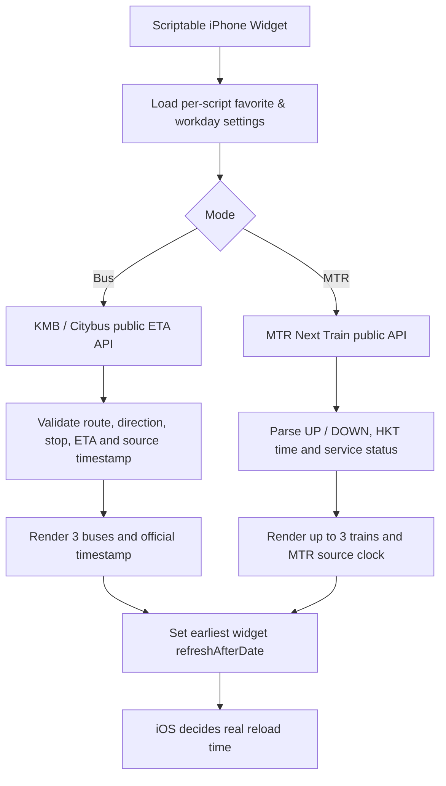

# Technical Methodology / 技術方法
[Back to README / 返回首頁](../README.md)

> **Scope:** Hong Kong transport arrival predictions presented by Scriptable on the iPhone Home Screen. This is a client-only, public-data demo. iOS decides actual widget refresh timing; the scripts cannot force 1-minute polling in the background.

## 1. Architecture / 架構



**廣東話：** 每個 Widget 只有喺 iOS 真正執行 JavaScript 嗰刻，先會向官方 API 攞新 ETA。畫面上的倒數可以由系統更新，但唔代表 ETA 本身已重新查詢。每條 Script 都有自己嘅收藏同設定，唔需要伺服器或 GPS 權限。

**English:** Each execution loads local configuration, makes an HTTPS request directly to an official provider, normalizes predictions, renders the widget, and sets the next *earliest permitted* refresh. There is no background daemon, location tracking, key, paid API, or server-side state.

## 2. Operator APIs / 官方 API

### Bus / 巴士

- KMB route-stop ETA: `GET https://data.etabus.gov.hk/v1/transport/kmb/eta/{stop_id}/{route}/{service_type}`
- KMB routes and stops: `/route-stop/{route}/{bound}/{service_type}`, `/stop`; stop names cached for 24 hours.
- Citybus V2 route-stop: `GET https://rt.data.gov.hk/v2/transport/citybus/route-stop/CTB/{route}/{bound}`
- Citybus V2 ETA: `GET https://rt.data.gov.hk/v2/transport/citybus/eta/CTB/{stop_id}/{route}`
- Citybus station details: `GET https://rt.data.gov.hk/v2/transport/citybus/stop/{stop_id}`; cached locally.
- API response `data` rows are filtered by route, direction (`O/I`), and stop sequence when available. ETA timestamps are parsed as ISO 8601, validated, sorted and reduced to the first three future predictions.
- Deduplication uses the ETA timestamp. Note: two buses predicted at exactly the same second would be collapsed by the current implementation; a future enhancement could dedupe by a robust trip identifier if available.

**Source time:** display `data_timestamp` (where provided) as `官方更新 HH:mm:ss HKT`; do not substitute `checkedAt` or `generated_timestamp` into this label. For the 180-second stale check, the code falls back to `generated_timestamp` if no valid `data_timestamp` exists. `generated_timestamp` is the API response creation time, so it is *not equivalent* to the original ETA data time.

**Data cadence:** operator ETA datasets state approximately one-minute source updates. Calling every 10 seconds does not guarantee a changed prediction.

Official references: [KMB dataset](https://data.gov.hk/en-data/dataset/hk-td-tis_21-etakmb), [Citybus API specification](https://www.citybus.com.hk/datagovhk/bus_eta_api_specifications.pdf).

### MTR / 港鐵

- Next Train API: `GET https://rt.data.gov.hk/v1/transport/mtr/getSchedule.php?line=TWL&sta=TWH&lang=TC`
- `line` / `sta`: official 3-character codes; e.g. `TWL` (Tsuen Wan Line) / `TWH` (Tai Wo Hau).
- `data["TWL-TWH"].UP` and `DOWN` list upcoming departures/arrivals. The script supports UP / DOWN / BOTH, and uses the `dest`, `time`, `plat` and `seq` fields where applicable. The current UI shows destination and expected time; platform can be added in a future update.
- `status=0` or a missing response is an error/alert, not evidence that trains are running normally. Response-level `isdelay=Y` is available in data but the current widget does not display a dedicated disruption badge.
- **Critical time-zone rule:** MTR `time`, `curr_time` and `sys_time` use date strings such as `2026-10-30 17:34:00` **without a timezone suffix**. Interpret them explicitly as **Hong Kong time (UTC+8)**, not as whichever time zone the phone is in.
- Displayed MTR `sys_time` is a provider clock, not a guarantee of live GPS location or a train-specific update event.

**Data cadence:** the MTR open-data dataset lists approximately 10-second upstream updates. That does **not** imply iOS Widget reloads every 10 seconds.

Official references: [MTR Next Train dataset](https://data.gov.hk/en-data/dataset/mtr-data2-nexttrain-data), [official data dictionary v1.7](https://opendata.mtr.com.hk/doc/Next_Train_DataDictionary_v1.7.pdf).

## 3. Adaptive refresh algorithm / 智能刷新算法

### Time arithmetic

1. Convert the actual UTC instant to **Asia/Hong_Kong** (fixed UTC+8, no DST).
2. Determine the local weekday; user may select *any* of Sunday–Saturday.
3. Compare the local clock with editable morning and evening commute windows.
4. Start a 10-minute warm-up before the selected commute window.
5. Choose a requested delay; if an upcoming warm-up starts earlier than that delay, set `refreshAfterDate` to that start instead.
6. iOS decides when the Widget actually reloads, potentially later than the requested date.

| State / 狀態 | Bus request | MTR request |
|---|---:|---:|
| Adaptive OFF | 1 min | 1 min |
| Commute + 10-min lead | 1 min | 1 min |
| Selected workday, 07:00–20:00 outside commute | 30 min | 5 min |
| Non-workday / night | 60 min | 15 min |

**Implementation detail:** Bus `getRefreshPlan()` and MTR `refreshPlan()` choose refresh dates rather than performing background polling. The bus Scriptable app screen additionally starts a *foreground-only* 30-second `Timer.schedule()` until that screen closes. The MTR public example offers a manual refresh menu instead of a permanently running app timer.

**Why this is an energy optimization, not real-time tracking:** At rest, the widget asks for fewer API executions. During a commute it asks more frequently, but the iOS WidgetKit budget still prevails. A user opening a widget explicitly triggers an app-side request, which is a more dependable way to fetch new data when a train/bus matters.

References: [Scriptable ListWidget.refreshAfterDate](https://docs.scriptable.app/listwidget/), [Apple WidgetKit timelines](https://developer.apple.com/documentation/WidgetKit/Keeping-a-Widget-Up-To-Date).

## 4. Persistence and isolation / 本機設定隔離

**Bus** (`FileManager.local()`, under Scriptable documents):

```text
HKBusETA/
├── Bus Home/
│   ├── favorites.json
│   └── settings.json
├── Bus Work/
│   ├── favorites.json
│   └── settings.json
├── kmb_stops.json
└── city_stops.json
```

The two scripts use independent destinations and workday schedules; only public stop-name caches are shared. On first install, both may copy a single legacy global `favorites.json` into their own directory. Subsequent edits are not shared. Renaming scripts changes their directory names; there is no automatic rename migration.

**MTR:** `HKMTR/<Script.name()>/favourite.json` and `adaptive.json`, separate from bus settings and from other MTR script names. This is a fresh implementation; no migration from an unknown earlier MTR format is promised.

**Privacy / 私隱：** Saved routes and commute times may reveal personal routines. They remain local; never commit a populated `favorites.json`, `settings.json`, `favourite.json`, `adaptive.json`, phone backups, or screenshots containing personal notifications without review. Public examples require no secrets and do not request location.

## 5. Request errors, stale data, edge cases / 失敗處理

| Situation | Behavior / 目前行為 |
|---|---|
| Provider/network timeout | Bus retries briefly (2x in widget, 3x in foreground), then displays error; MTR displays an error without retry loop |
| No future ETA | Clear no-predictions message instead of an invented arrival time |
| Bus source timestamp over 180s old at render | The bus widget displays a stale warning instead of normal countdown rows |
| Bus source timestamp absent | Footer says the official time is unavailable (no fabricated fallback) |
| Widget not reloaded for 20 min | Already-rendered text may be stale; the bus code only checks staleness *when re-executed* |
| Train/route service changes | Official data can change or be unavailable; no guarantee of service coverage |
| Dynamic countdown reaches zero | The displayed prediction is not proof of actual vehicle arrival |
| Two bus journeys have identical ETA | Current timestamp-only deduplication may merge them |
| Selected workday changed | Saved locally for that particular Script; takes effect on its next execution |

**Accuracy controls:** No invented ETA, no 100% claims of 60-second refresh, no API key, no location permissions. Displays prediction not certainty. Also note that a `data_timestamp` can advance without a prediction changing, and an unchanged `data_timestamp` does not necessarily mean the whole API is inaccessible.

## 6. Validation / 測試計劃

### Checked locally

- `node --check` for both JavaScript scripts; no syntax errors.
- Isolated, mocked scheduling/time-zone checks for bus and MTR: Monday 07:30 HKT commute, Monday 07:20 warm-up, weekday 12:00 off-peak, Saturday, adaptive OFF; MTR `2026-10-30 17:34:00` interpreted as `2026-10-30T09:34:00Z`.
- **Not verified:** live iPhone Widget rendering, device-specific fonts/spacing, exact provider uptime, current MTR service or exact correspondence between the new public MTR code and the submitted MTR screenshot.

### Phone acceptance checklist / iPhone 驗收

1. Install each script, run it manually, and confirm the desired line, direction and station.
2. Add small/medium widgets; check route and stop text is not clipped.
3. Confirm three ETA rows and provider time when available.
4. Toggle adaptive ON/OFF, customize workdays (including weekends), and change commute windows.
5. Create `Bus Home` and `Bus Work`; remove/change a favorite in one, confirm the other remains unchanged.
6. Verify an API error displays a warning and no fabricated time.
7. Compare one prediction with the operator's official service; evaluate deviations before relying on it for travel.
8. Observe actual iOS Home Screen reload cadence; do not assume requested intervals are enforced.

## 7. Planned improvements / 可延伸

- Handle identical bus ETAs with trip identifiers where the provider supports them.
- MTR destination-specific user-friendly direction labels and explicit platform display.
- A separate manually launched high-frequency view for active commuting without presenting it as background widget refresh.
- Optional freshness indicators based on the rendered timestamp and a follow-up device test matrix.
- More robust test fixtures for malformed API responses, service disruption and midnight boundaries.

---
**License note:** no software license has been added; please choose one deliberately before accepting external redistribution or derivative usage. API datasets have their own provider terms, which this repository does not supersede.


## 9. Bus countdown rollover / 巴士倒數過零問題 (v2.4)

**原因 / Cause:** Scriptable `WidgetDate.applyTimerStyle()` adopts iOS's live timer. For future dates it counts down, **then counts up once the ETA has passed**, even if the widget has not fetched a fresh ETA. A value that looks like an arrival time may instead be a large elapsed timer. This is expected dynamic-date behavior, not proof that the operator has changed the ETA. Apple describes this behavior in its [dynamic date documentation](https://developer.apple.com/documentation/widgetkit/displaying-dynamic-dates).

**修正 / Mitigation:** The bus widget now defaults to `prefs.countdownMode = 'snapshot'`, rendered with `WidgetText` using the difference between ETA and the **last widget execution time**. This prevents the text from automatically counting upward or changing its display style, while maintaining the three-row typography and the explicit arrival time at right. ETA already past at execution is marked `已過時`. It does **not** continue decrementing while the script is inactive, so these values are snapshots and should not be treated as continuously fresh ETAs.

**可選 Live mode / Optional live mode:** Choose **⚙ 通勤設定 → 倒數顯示 → 動態** to restore `applyTimerStyle()` and second-by-second countdown. On overdue ETAs it may again count up. Scriptable does not expose a bounded-stop dynamic timer via the documented WidgetDate interface. iOS controls the next execution in either mode. **Do not infer that a snapshot is fresh from the visual countdown alone.** The official data timestamp and absolute arrival time are preserved.
