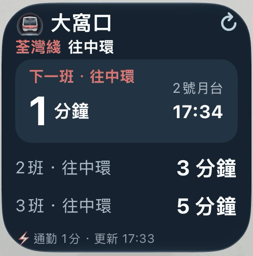
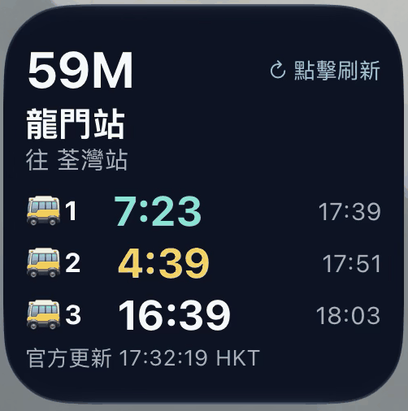

# 香港港鐵＋巴士 ETA Widget 完整教學（廣東話）

[返回主頁](../README.md) · [English guide](README_en.md)

## 1. 做到啲乜？

本專案有兩份**獨立 Scriptable JavaScript**：一份查港鐵下一班車，一份查九巴／城巴到站時間。唔需要申請 API Key、唔需要自設 Server。喺 iPhone 主畫面加入 Widget 就可以睇班次。提供香港時間（HKT，UTC+8）顯示，唔受手機所在地時區影響。

| 🚇 港鐵 | 🚌 巴士 |
|---|---|
|  |  |

> 截圖只係用戶提供嘅版面例子；上面嘅時間唔係即時列車／巴士數據。

## 2. 安裝港鐵 Widget

1. iPhone 安裝 **Scriptable** App，打開後按 `+` 建立 Script。
2. 建議命名 `MTR Home`，複製 [`scripts/HK_MTR_Next_Train.js`](../scripts/HK_MTR_Next_Train.js) **完整原始 JavaScript** 貼入；唔好貼 `{"code": ...}` JSON 包裝。
3. 第一次喺 Scriptable App 執行，跟住畫面揀**路線 → 車站 → 方向**（兩個方向／UP／DOWN）。
4. 可按 `↻ 即時刷新`、`⇄ 更改方向`、`⌖ 更換路線／車站`。
5. 返回 iPhone 主畫面，長按空白位置加入 **Scriptable Widget**，選擇 Small／Medium／Large，再長按該 Widget → 編輯 Widget → **Script: MTR Home**。Widget 參數可留空，使用已儲存嘅車站。
6. 如想兩個獨立常用站，複製 Script，改名 `MTR Work`，各自執行設定。兩份 Script 嘅收藏同 Adaptive 設定唔會互相覆蓋。

### 港鐵 Widget Parameter

Widget 編輯畫面嘅 `Parameter` 可以固定路線／車站／方向，格式：`路線碼,車站碼,方向`。例如：

| 輸入 | 效果 |
|---|---|
| `TWL,TWH,DOWN` | 荃灣綫大窩口，往中環 |
| `TCL,OLY,UP` | 東涌綫奧運，往東涌 |
| `TKL,TKO,UP` | 將軍澳綫將軍澳，往寶琳／康城 |
| `ISL,CAB,BOTH` | 港島綫銅鑼灣，兩個方向 |

注意：`UP/DOWN` 係**港鐵 API 方向代碼**，唔代表所有路線嘅北／南行。分支線、特別班次以 API 每班車返回嘅 `dest` 為準。Widget Parameter 只係個別 Widget 覆蓋顯示設定，唔會改變另一個 Widget 嘅收藏。

## 3. 安裝巴士 Widget

1. 新增另一份 Script，命名 `Bus Home`；複製 [`scripts/HK-Bus-ETA.js`](../scripts/HK-Bus-ETA.js) 全部內容貼入。
2. 第一次喺 Scriptable 執行：揀**九巴／城巴 → 輸入路線 → 選方向 → 選巴士站**。例如你可以搵 `59M`，揀對應方向同龍門站；實際可選站點以官方 Route-Stop API 為準。
3. 進入列表後可新增其他常用站、移除收藏、按 `🔄 立即刷新`，或打開 `⚙ 通勤設定`。
4. 主畫面新增 Scriptable Widget，將 **Script** 設成 `Bus Home`。若有多個收藏，可用 Widget `Parameter` 輸入**收藏序號**（如 `1`）或**路線號**（如 `59M`）挑選顯示嘅一個收藏。路線號重複時會揀第一個匹配項，想精確指定就用收藏序號。
5. 巴士版使用 iOS `addDate(...).applyTimerStyle()`，Widget 畫面上嘅倒數**可能隨時間變化**，但新班次仍然要等 Scriptable/iOS 重新查詢。

### 截圖所見係咪所有裝置都一樣？

唔一定。Widget 字體與可用空間會受 iPhone 型號、iOS 版本、Widget Size、文字縮放影響。如果發生截斷，建議先用相同 Small Widget 尺寸測試；Medium／Large 顯示數量不同。

## 4. Adaptive Mode：點樣節省 API 請求？

### 港鐵預設

喺 Scriptable App 內可開關 `⚡ Adaptive Mode`、逐日選工作日、修改兩個通勤時段。預設星期一至五 07:00–10:00／17:30–20:00（香港時間）。

| 模式 | 要求 Widget 最早下一次更新 | 快取 |
|---|---|---|
| Adaptive OFF | 1 分鐘 | Widget 每次執行直接查詢 |
| Adaptive ON，返／放工時段 | 1 分鐘 | 60 秒內可能沿用已查資料 |
| Adaptive ON，工作日非通勤 | 5 分鐘 | 最多按該時段間隔重用資料 |
| Adaptive ON，非工作日 | 15 分鐘 | 最多按該時段間隔重用資料 |

**重要**：Adaptive 係**減少頻率**，唔係關閉 API。港鐵 Script 會用 `Script.name()` 隔離每份 Script 嘅 `favourite.json`、`adaptive.json` 同指定車站快取。手動喺 App 重新查詢會跳過正常 Widget 快取；網絡失敗時可能短時間顯示舊快取並標示。低頻模式嘅 ETA 只供參考，趕車時應立即打開 App 查最新。

### 巴士預設

巴士 Script 設有獨立通勤設定，**唔會直接沿用港鐵嘅設定**：預設星期一至五 07:30–09:30／18:00–20:00；通勤前 10 分鐘為「通勤預備」。

| 模式 | 要求 Widget 最早下一次更新 |
|---|---|
| Adaptive OFF | 1 分鐘 |
| 通勤／通勤預備 | 1 分鐘 |
| 其他工作日日間（07:00–20:00） | 30 分鐘 |
| 夜間、非工作日 | 60 分鐘 |
| Scriptable 前台列表保持開啟 | 約每 30 秒重新查詢 |

**分別**：目前巴士版係調節 Widget **執行時間要求**，唔係將每次巴士 API 回應持久快取。當 iOS 實際執行 Widget，就會呼叫巴士 ETA API；初次加路線亦會額外查路線、站點資料。

### 點解設定 1 分鐘但未必真係 1 分鐘？

`widget.refreshAfterDate = new Date(...)` 意思係「**最早容許 iOS 再執行**」，唔係背景定時器。iOS 可能因省電、背景預算或使用頻率而延遲。主畫面 `↻` 係**開啟 Scriptable** 嘅連結，唔係保證喺 Widget 內直接呼叫 API 同重畫畫面。唔建議為咗強制每 10 秒更新而長時間輪詢。

## 5. 技術方法／資料流程

### 港鐵

1. 由已儲存收藏、Widget Parameter 或 URL Query 決定 `line`、`station`、`direction`。
2. 使用香港日期／星期／時段計算 Adaptive 目標間隔。
3. Widget 先檢查自己 Script 名稱下嘅站點快取；快取仍有效就重用，否則向 `https://rt.data.gov.hk/v1/transport/mtr/getSchedule.php?line=...&sta=...&lang=TC` 取 JSON。
4. 依 `data[LINE-STATION].UP`／`.DOWN` 揀方向，讀 `time`、`dest`、`plat` 等欄位；用香港時間（UTC+8）換算絕對時間，按手機現時時間計算剩餘分鐘，排除已過期班次。
5. 以 Scriptable `ListWidget`／`Stack` 顯示大字下一班、其後班次及官方更新時間。若 Adaptive 命中低頻快取，會顯示快取提示。
6. 設定 `refreshAfterDate`，交畀 iOS 決定下一次實際執行。

### 巴士

1. 由用戶揀巴士公司、路線、方向；用 `route-stop` 查該方向停站、`stop` 查中文站名，儲存至自己 Script 嘅 `favorites.json`。
2. 查指定站嘅 KMB 或 CTB ETA API，按路線、方向及站序篩選，最多列出三班。
3. 按 ETA ISO 時間計算剩餘時間，亦使用 iOS 原生倒數日期元件展示動態倒數；`data_timestamp`／`generated_timestamp` 用嚟顯示營運商更新時間，若過期會發警告。
4. 前台可按刷新或約每 30 秒重新查詢；Widget 會按照 Adaptive 更新時段向 iOS 提出下一次執行時間。

### API 更新頻率 ≠ Widget 更新頻率

港鐵資料源約每 **10 秒** 更新；巴士 ETA 資料源約每 **60 秒** 更新。但 API 有新數據，唔代表 iOS 已經重新執行 Widget。特別係 Widget 畫面顯示嘅「剩餘 X 分鐘」，除非用 iOS 原生相對日期元件，否則通常只係上一個 Widget 執行時嘅靜態數字。

## 6. 檔案分隔、私隱同安全

- 港鐵：`FileManager.local().libraryDirectory()/HKMTR_EdgeToEdge/<Script.name 編碼>/favourite.json`，另有 `adaptive.json` 及快取檔。
- 巴士：`FileManager.local().documentsDirectory()/HKBusETA/<Script.name>/favorites.json` 同 `settings.json`。
- 巴士版首次啟動時，若舊版 `HKBusETA/favorites.json` 存在而新目錄冇收藏，會**複製一次**作遷移；此後唔共用檔案、唔同步修改。
- **唔好將本機收藏、快取、原始使用記錄或包含個人資料嘅截圖提交到公開 GitHub**。本 repo 只提交兩份 Script 源碼、說明文件同經裁剪嘅 Widget 示範截圖。
- 程式唔需要 API Key，亦冇自行設定遙測伺服器。不過每次 API 請求仍會經網絡送到相關數據提供方；唔等同完全離線。

## 7. 常見問題

**Q：第一行 `Unexpected token ':'`？**
A：通常係將 `{"code": "..."}` 當 JavaScript 貼咗入去。只貼 `.js` 檔內容，第一行應該係 `// ...` 註解。

**Q：兩個 Widget 點解見到同一個站？**
A：如果兩個 Widget 指向**同一份 Script**，又冇各自設定 `Parameter`，自然會用同一收藏。要完全獨立設定，建立兩份**唔同名稱**嘅 Script；或喺港鐵 Widget Parameter 指定各自 `line,station,direction`。

**Q：API 話冇資料／列車唔郁？**
A：檢查路線站碼、網絡、服務時間、官方 API 有冇延誤；開 Scriptable 人手刷新。不要將低頻快取當作即時列車保證。

**Q：會唔會扣好多電？**
A：背景頻率由 iOS 管理；通勤以外降低 Widget 更新要求可減少請求機會。巴士前台每 30 秒刷新只適用於表格畫面仍然運行期間。

**Q：點做最基本驗證？**
A：喺電腦有 Node.js 嘅情況可執行 `node --check scripts/HK_MTR_Next_Train.js` 同 `node --check scripts/HK-Bus-ETA.js`。語法通過只代表 JS 可解析，唔代表已通過 iPhone Scriptable 實機 UI 或即時 API 整合測試。

## 8. 官方參考

- [港鐵即時列車數據](https://data.gov.hk/en-data/dataset/mtr-data2-nexttrain-data)
- [港鐵 Next Train API 技術規格](https://opendata.mtr.com.hk/doc/Next_Train_API_Spec_v1.3.pdf)
- [九巴／龍運 ETA Open Data](https://data.gov.hk/en-data/dataset/hk-td-tis_21-etakmb)
- [城巴 ETA Open Data](https://data.gov.hk/en-data/dataset/ctb-eta-transport-realtime-eta)
- [Scriptable ListWidget 文件](https://docs.scriptable.app/listwidget/)
